# Projeto TCC — Thesium

Uma plataforma web para organizar grupos, propostas e a escolha de orientadores de Trabalhos de Conclusão de Curso em um ambiente compartilhado por alunos, professores e coordenação.

Este repositório pessoal reúne a apresentação, as principais ideias e as capturas de interface do **Thesium**, projeto acadêmico desenvolvido pela equipe da organização [Thesium — Gestão de TCC](https://github.com/Thesium-Gestao-de-TCC). O código da aplicação e seus componentes são mantidos nos repositórios oficiais da organização, relacionados em [Mapa dos repositórios](#repositorios).

**Documentação pessoal:** [Gabriella](https://github.com/GaBriellaCaRdosoInacio) · **Referência original:** [Projeto](https://github.com/Thesium-Gestao-de-TCC/Projeto)

> **A IA sugere; o coordenador decide.**

[Conheça a proposta](#proposta) · [Veja a interface](#interface) · [Entenda o matching](#matching) · [Explore a arquitetura](#arquitetura) · [Execute o projeto](#execucao) · [Consulte as evidências](#evidencias)

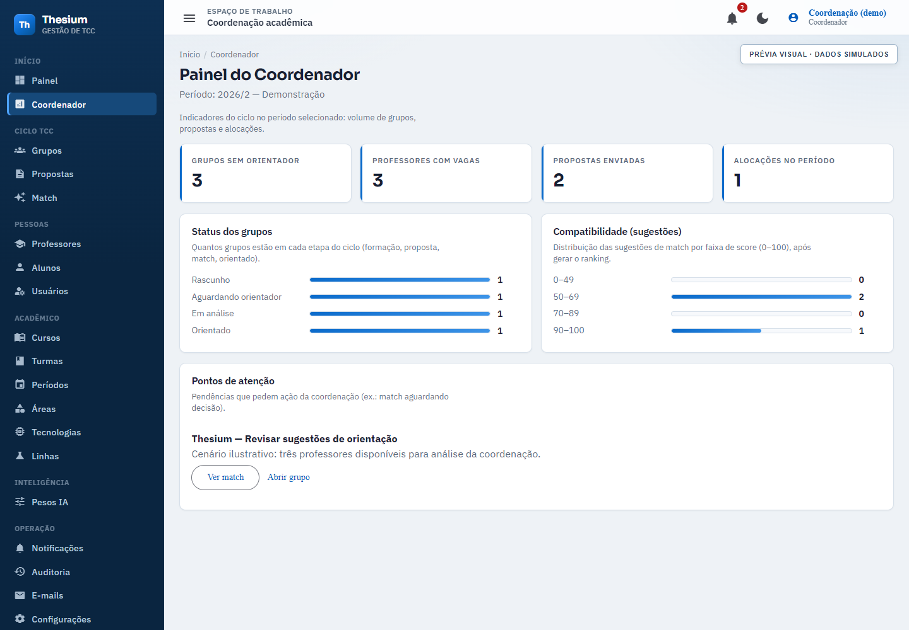

*Interface Angular do projeto. Os indicadores e demais dados desta prévia são simulados; as condições das capturas estão descritas em [Interface](#interface) e [Evidências](#evidencias).*

<a id="proposta"></a>
## Por que o Thesium existe?

A organização de TCCs envolve informações distribuídas entre estudantes, docentes e coordenação: temas de pesquisa, composição dos grupos, propostas, especialidades dos professores e vagas de orientação. Quando esse processo depende de planilhas, mensagens e documentos isolados, fica mais difícil acompanhar pendências e comparar possíveis orientadores.

O **Thesium** propõe centralizar essas informações e apoiar a coordenação na associação entre grupos e professores. A recomendação considera o tema do trabalho, tecnologias, áreas de pesquisa, experiência e disponibilidade do docente. O resultado é apresentado para revisão humana, com notas parciais e justificativas.

O projeto é desenvolvido no contexto de um **Trabalho de Conclusão de Curso**. **Thesium** é o nome apresentado ao usuário; **OrientAI** permanece em nomes técnicos da solução, pastas, banco de dados e materiais de referência.

### Principais ideias

- **Um contexto acadêmico compartilhado:** pessoas, cursos, turmas, períodos e catálogos em um mesmo fluxo.
- **Propostas estruturadas:** problema, objetivos, resumo, área e tecnologias organizados para consulta e análise.
- **Perfis docentes relevantes para a orientação:** biografia, palavras-chave, áreas, tecnologias e vagas disponíveis.
- **Recomendação com critérios visíveis:** ranking acompanhado de score, notas parciais e justificativa.
- **Decisão humana registrada:** a coordenação aprova ou rejeita sugestões; a aprovação registra a alocação e seu histórico.
- **Continuidade sem chave de IA:** há uma alternativa heurística local quando a integração externa não está configurada ou falha.

Os benefícios de organização, aderência da recomendação e redução de esforço são objetivos do projeto. Sua comprovação depende de avaliação; as telas, por si só, não estabelecem esses resultados.

## Para quem é?

| Perfil | Participação no processo |
|---|---|
| **Aluno** | Cria grupo, participa de convites, prepara e envia propostas, anexa documentos e acompanha notificações. |
| **Professor** | Mantém o perfil de orientação, informa especialidades e disponibilidade e consulta grupos e propostas conforme as permissões. |
| **Coordenador** | Acompanha o período, consulta pendências, gera rankings e decide sobre as sugestões de orientação. |
| **Administrador** | Acessa recursos administrativos, cadastros e configurações previstos nas políticas da aplicação. |

## Como o processo funciona

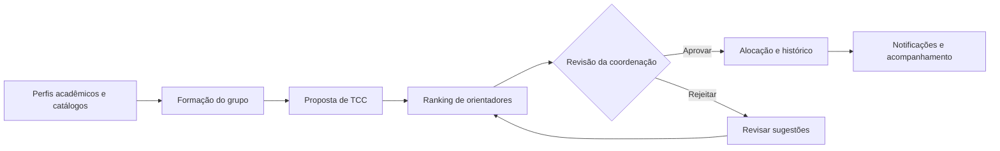

1. A instituição organiza os cadastros acadêmicos, e os professores informam suas áreas, tecnologias e vagas.
2. Os estudantes formam grupos e respondem aos convites de participação.
3. O grupo estrutura sua proposta e reúne documentos e comentários.
4. A coordenação solicita sugestões entre os professores elegíveis.
5. O sistema apresenta um ranking com critérios e justificativas para revisão.
6. A coordenação aprova ou rejeita a sugestão. Na aprovação, o sistema atribui o orientador, consome uma vaga e registra a decisão, a alocação, o histórico e notificações.

## Funcionalidades presentes no código

| Módulo | Recursos |
|---|---|
| **Acesso e conta** | Login, autorização por perfil, recuperação, redefinição e alteração de senha. |
| **Painéis** | Visão por perfil e painel da coordenação com indicadores, distribuição de status e pendências. |
| **Grupos** | Criação, consulta, integrantes, convites com aceite ou recusa e identificação do orientador. |
| **Propostas** | Rascunho, envio, versões, consulta de conteúdo, comentários e anexos em PDF, DOC ou DOCX, com limite de 10 MB por arquivo. |
| **Professores** | Consulta de docentes e edição do próprio perfil, áreas, tecnologias e disponibilidade. |
| **Matching** | Geração de sugestões, ranking, score, notas parciais, justificativas, aprovação e rejeição. |
| **Pessoas** | Gestão de usuários, consulta de alunos e importação de alunos por CSV. |
| **Cadastros acadêmicos** | Cursos, turmas, períodos, áreas, tecnologias e linhas de pesquisa. |
| **Operação** | Central de notificações, consulta de auditoria e registros da outbox de e-mails. |
| **Experiência de uso** | Navegação por perfil, tema claro/escuro, tabelas compartilhadas e estados de carregamento ou ausência de dados. |

Esta relação descreve a implementação consultada, sem representar homologação de todos os fluxos. A consulta à outbox também não comprova entrega de mensagens por um provedor de e-mail. O recorte atual se concentra em grupos, propostas e orientação; bancas, notas e a avaliação completa do TCC não são apresentados como funcionalidades concluídas.

<a id="interface"></a>
## Interface

As imagens abaixo são **capturas do front-end Angular existente**, executado em uma cópia temporária do projeto. Nas telas autenticadas, sessões de demonstração e respostas HTTP simuladas foram fornecidas pelo navegador para preencher os componentes, sem alterar o código-fonte dos repositórios.

**Nomes, indicadores, scores, justificativas e estados exibidos são fictícios e ilustrativos.** As capturas documentam a apresentação visual; não comprovam autenticação na API, persistência, execução da IA ou aprovação real de uma orientação. Cada prévia autenticada contém uma identificação de dados simulados.

### Acesso

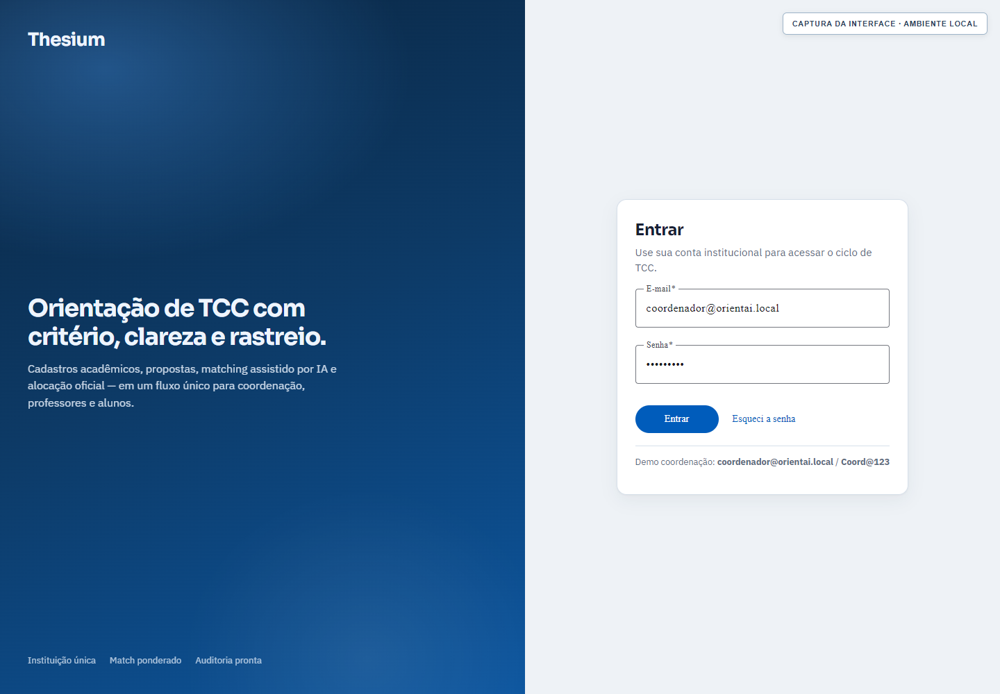

*Entrada na plataforma e acesso à recuperação de senha. A captura não representa um login validado pela API.*

### Grupos e acompanhamento

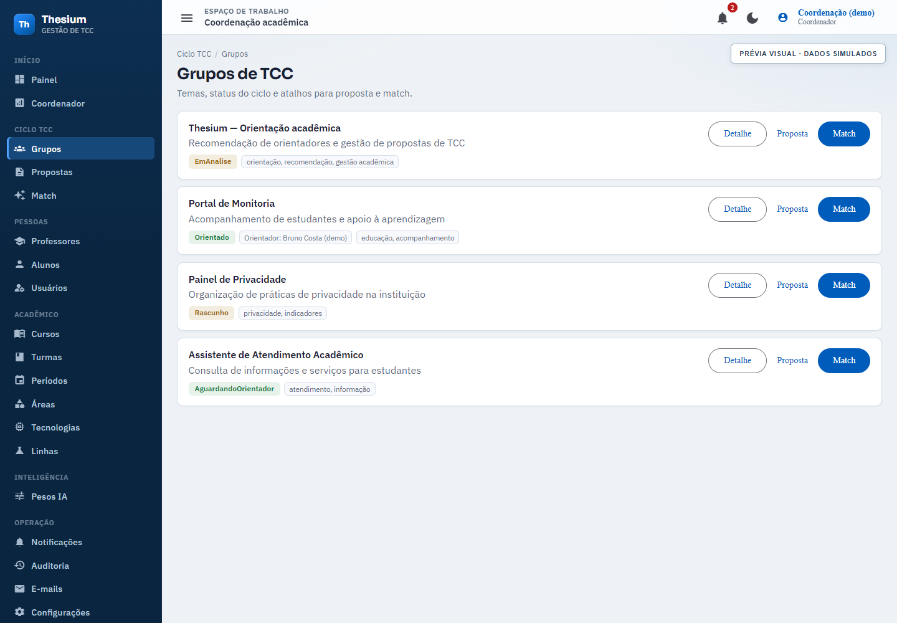

*Consulta dos grupos, temas, status e atalhos para detalhes, proposta e matching.*

### Proposta de TCC

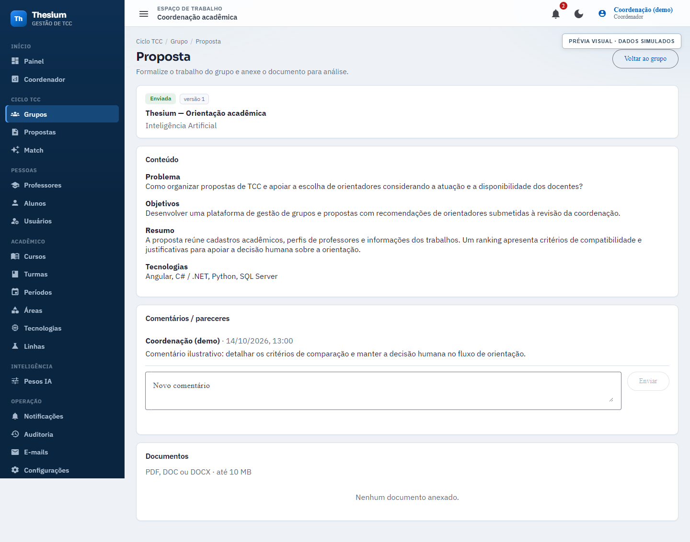

*Organização do conteúdo acadêmico, comentários e área de documentos em uma mesma tela.*

### Recomendação de orientadores

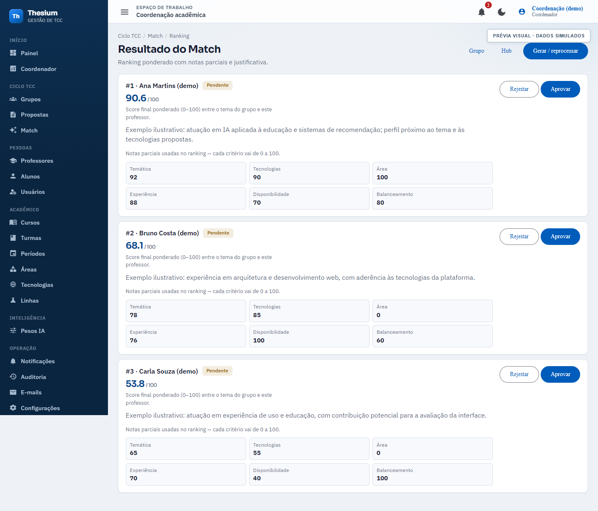

*Exemplo visual de ranking, critérios, justificativas e ações de aprovação ou rejeição. Os scores desta captura não foram calculados pelo serviço de IA.*

### Grupo com orientador

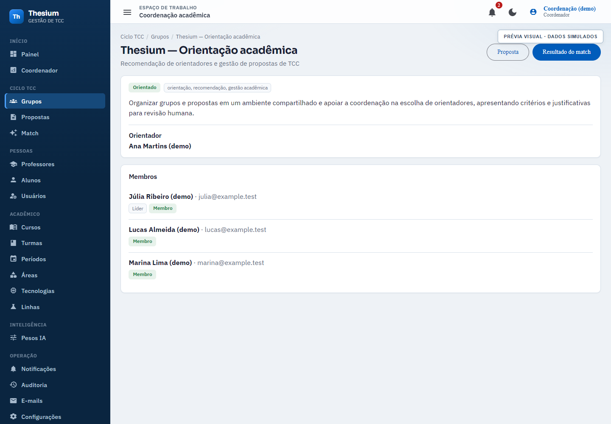

*Representação do estado orientado. Esta captura utiliza uma resposta simulada e não é evidência de uma aprovação persistida.*

<details>
<summary><strong>Ver mais telas: aluno, professor, configuração e notificações</strong></summary>

### Espaço do aluno

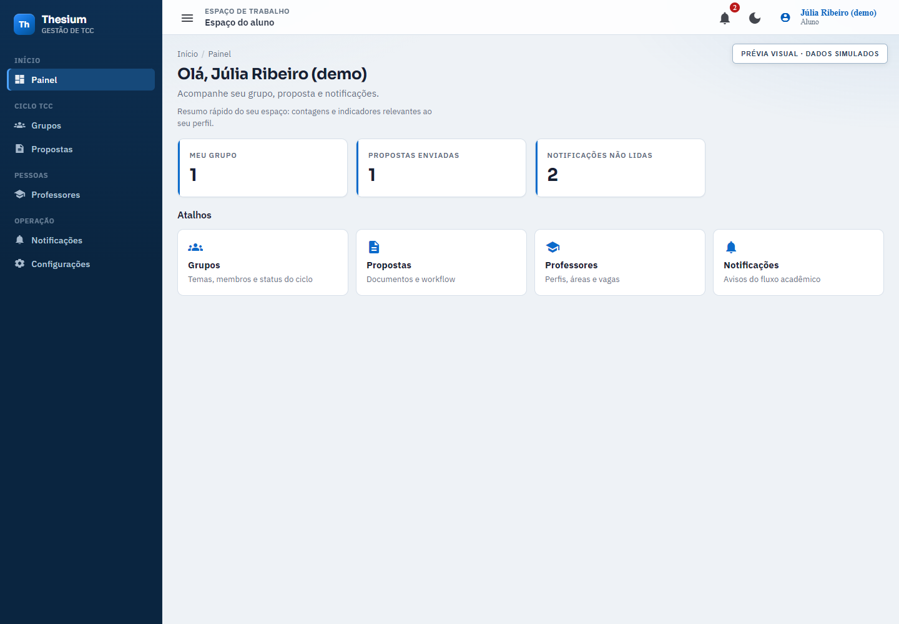

*Atalhos para grupos, propostas, professores e notificações.*

### Perfil do professor

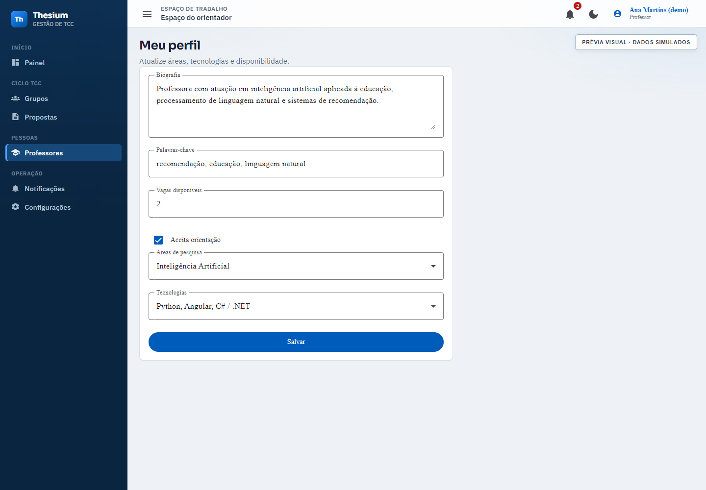

*Dados que ajudam a caracterizar a atuação e a disponibilidade do orientador.*

### Configuração dos pesos

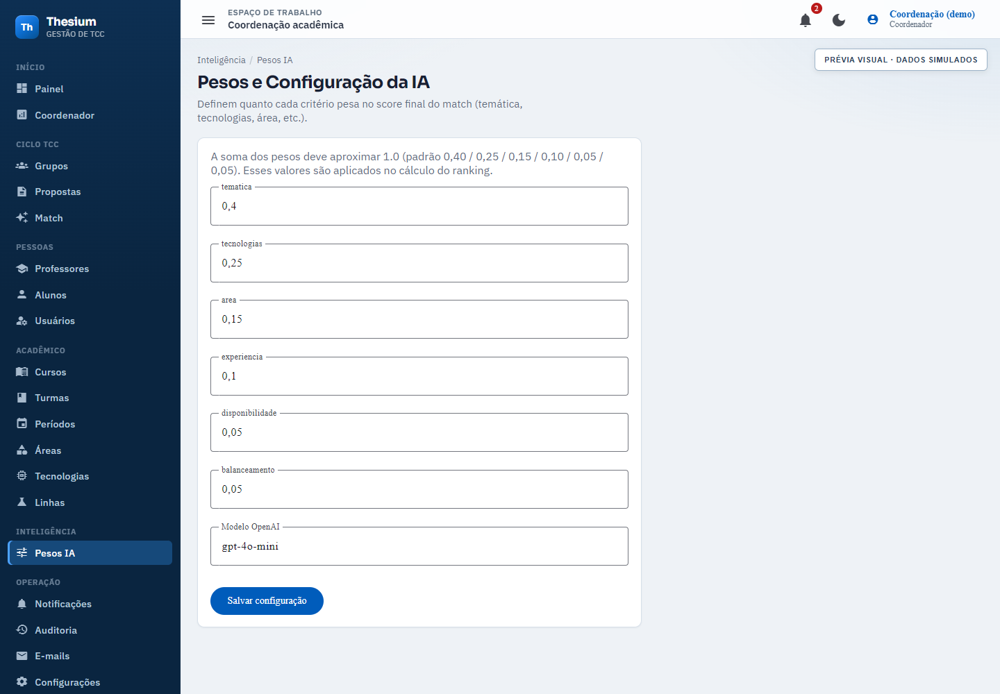

*Interface para configuração de pesos e campo de modelo. O comportamento efetivo do modelo no serviço está explicado em [Matching](#matching).*

### Central de notificações

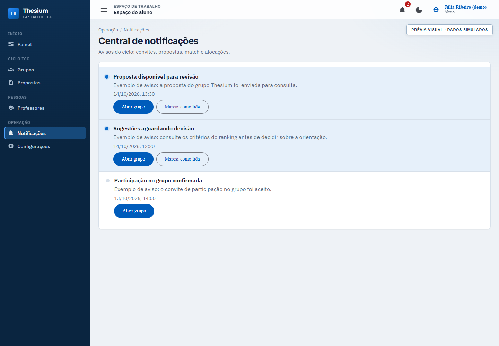

*Avisos e atalhos de acompanhamento do ciclo acadêmico.*

</details>

<a id="matching"></a>
## Como funciona a recomendação

### Entradas e elegibilidade

O serviço utiliza título, tema, resumo, palavras-chave e objetivos do trabalho, além das tecnologias e da área disponíveis na proposta. Para cada professor, considera biografia, palavras-chave, áreas, tecnologias, vagas e carga de orientações.

A elegibilidade considera o aceite de orientação, a existência de vagas e os filtros do repositório de professores. A aprovação revalida a elegibilidade e impede uma segunda alocação para um grupo que já possui orientador.

### Avaliação e ranking

- **Com a integração configurada:** um modelo de linguagem recebe o contexto e retorna notas de temática, tecnologias e experiência, acompanhadas de justificativa.
- **Sem chave configurada ou em caso de falha:** uma heurística local calcula sobreposição lexical e de tecnologias, usando similaridade de Jaccard.
- **Nos dois caminhos:** o código calcula área, disponibilidade e balanceamento e combina as notas no score final.

| Critério | Peso padrão |
|---|---:|
| Temática | 40% |
| Tecnologias | 25% |
| Área de pesquisa | 15% |
| Experiência | 10% |
| Disponibilidade | 5% |
| Balanceamento da carga | 5% |

```text
score = 0,40 × temática + 0,25 × tecnologias + 0,15 × área
      + 0,10 × experiência + 0,05 × disponibilidade + 0,05 × balanceamento
```

Os pesos podem ser carregados da configuração persistida. As sugestões são ordenadas por score, e a coordenação revisa os candidatos antes de decidir. **O score é um valor de ordenação, não uma probabilidade de sucesso nem uma medida de acurácia.**

Na versão consultada, o serviço lê o modelo de `OpenAI:Model`. Embora a tela administrativa tenha um campo de modelo salvo como `OpenAIModel`, seu uso pelo serviço ainda precisa ser alinhado e validado. A integração atual usa avaliação por modelo de linguagem e heurística; embeddings ou busca vetorial não são descritos como componentes já implementados.

Referências: [documentação do matching](https://github.com/Thesium-Gestao-de-TCC/Back-end/blob/main/docs/07-ia-e-match.md), [serviço de avaliação](https://github.com/Thesium-Gestao-de-TCC/Back-end/blob/34fd7c4831093cb5e31ab84a2f5072d1d5dc7116/src/OrientAI.Infrastructure/OpenAI/OpenAiMatchingService.cs) e [cálculo do score](https://github.com/Thesium-Gestao-de-TCC/Back-end/blob/34fd7c4831093cb5e31ab84a2f5072d1d5dc7116/src/OrientAI.Application/Matches/MatchScoreCalculator.cs).

<a id="arquitetura"></a>
## Arquitetura e tecnologias

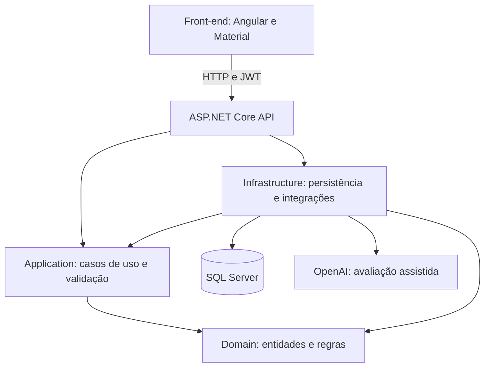

| Camada ou recurso | Tecnologia / responsabilidade |
|---|---|
| **Interface** | Angular 20, TypeScript e Angular Material; componentes standalone, rotas, guards e interceptors. |
| **API** | ASP.NET Core 8, controladores REST, políticas de autorização e Swagger/OpenAPI. |
| **Aplicação** | Casos de uso com CQRS/MediatR, DTOs, FluentValidation e cálculo do matching. |
| **Domínio** | Entidades, estados, regras de negócio e contratos de repositório. |
| **Infraestrutura** | Entity Framework Core, repositórios, unidade de trabalho, migrations, seed e cliente de IA. |
| **Persistência local** | SQL Server 2022 em Docker; o schema em execução é aplicado pelas migrations da API. |
| **Autenticação** | JWT Bearer e hash de senhas com BCrypt. |

O back-end segue a organização em camadas da **Clean Architecture**. Mais detalhes estão na [documentação de arquitetura](https://github.com/Thesium-Gestao-de-TCC/Back-end/blob/main/docs/01-arquitetura.md) e no [modelo de dados](https://github.com/Thesium-Gestao-de-TCC/Back-end/blob/main/docs/02-banco-de-dados.md).

<a id="repositorios"></a>
## Mapa dos repositórios

| Repositório | Responsabilidade |
|---|---|
| [**Projeto-TCC-Thesium**](https://github.com/GaBriellaCaRdosoInacio/Projeto-TCC-Thesium) | Este repositório pessoal: apresentação do projeto, principais ideias, capturas da interface e referências para evidências e código. |
| [**Projeto — organização**](https://github.com/Thesium-Gestao-de-TCC/Projeto) | Repositório original de referência e materiais gerais do projeto na organização. |
| [**Front-end**](https://github.com/Thesium-Gestao-de-TCC/Front-end) | Aplicação Angular e experiência dos diferentes perfis. |
| [**Back-end**](https://github.com/Thesium-Gestao-de-TCC/Back-end) | API, regras de negócio, matching, migrations e documentação técnica. |
| [**Database**](https://github.com/Thesium-Gestao-de-TCC/Database) | Configuração do SQL Server em Docker e schema de referência. |
| [**Architeture-AWS**](https://github.com/Thesium-Gestao-de-TCC/Architeture-AWS) | Repositório reservado para arquitetura em nuvem; sem conteúdo publicado na consulta desta documentação. |

No repositório original **Projeto**, `OrientAI.zip` é um material de referência, e a entrada `OrientAI` está registrada como um vínculo Git a outro commit, sem `.gitmodules` versionado na versão consultada. Este repositório pessoal contém o README e as capturas, sem copiar esse arquivo ou vínculo. Para executar e consultar a aplicação, use os repositórios oficiais separados acima.

<a id="execucao"></a>
## Executar localmente

### Pré-requisitos

- Git.
- Node.js compatível com Angular 20 e npm: série 20 a partir de 20.19, série 22 a partir de 22.12 ou versão 24+.
- .NET 8 SDK.
- Docker Desktop com suporte a contêineres Linux para o SQL Server.
- Chave de API OpenAI opcional; sem ela, o matching usa a alternativa heurística.

Mantenha os repositórios de execução lado a lado:

```text
Thesium/
├── Projeto-TCC-Thesium/  # apresentação e capturas
├── Database/
├── Back-end/
└── Front-end/
```

Em PowerShell, a partir da pasta que receberá os repositórios:

```powershell
git clone https://github.com/Thesium-Gestao-de-TCC/Database.git
git clone https://github.com/Thesium-Gestao-de-TCC/Back-end.git
git clone https://github.com/Thesium-Gestao-de-TCC/Front-end.git
```

**1. Banco de dados**

```powershell
cd Database
.\scripts\start-sql.ps1
```

**2. API — em outro terminal, a partir da pasta Thesium**

```powershell
cd Back-end
.\scripts\run-api.ps1
```

**3. Interface — em outro terminal, a partir da pasta Thesium**

```powershell
cd Front-end
.\scripts\run-web.ps1
```

| Serviço | Endereço local |
|---|---|
| Interface | `http://localhost:4200` |
| API | `http://localhost:5049/api` |
| Swagger em desenvolvimento | `http://localhost:5049/swagger` |
| SQL Server | `localhost,1433` |

A API aplica migrations e inicializa a massa de demonstração no startup, conforme as condições do seeder. As credenciais de demonstração e os cenários estão no [guia da massa demo](https://github.com/Thesium-Gestao-de-TCC/Back-end/blob/main/docs/MASSA-DEMO.md). Use a configuração local documentada pelos componentes; chaves pessoais de API devem ficar fora de arquivos versionados, por exemplo em variáveis de ambiente ou user secrets.

Consulte o [guia completo de execução](https://github.com/Thesium-Gestao-de-TCC/Back-end/blob/main/docs/COMO-RODAR.md) para configuração de conexão, portas e solução de problemas. Este roteiro descreve a execução integrada prevista; a preparação das capturas deste README executou apenas o front-end com respostas simuladas.

<a id="evidencias"></a>
## Evidências e rastreabilidade

### O que está disponível

| Material | O que permite verificar | Limite da evidência |
|---|---|---|
| **Capturas deste README** | Apresentação dos componentes e telas Angular com cenários demonstrativos. | Respostas simuladas; sem teste de API, banco, autenticação real ou IA. |
| **Código-fonte dos componentes** | Existência das telas, contratos, regras e integrações descritas. | Inspeção do código não substitui teste integrado. |
| **Documentação técnica** | Arquitetura, dados, API, telas, matching e instruções de execução. | Deve ser confrontada com a versão utilizada na demonstração. |
| **Massa demo documentada** | Cenários para grupos, propostas, pessoas e operação. | Dados de demonstração não equivalem a corpus validado para medir qualidade. |
| **Protocolo e resultados experimentais** | Futuramente, avaliação independente da recomendação e do esforço de uso. | Não há resultados experimentais apresentados neste README. |

A documentação da massa demo descreve aproximadamente **18 professores, 60 alunos e 25 grupos**, além dos catálogos e registros de operação. Esses valores são referência do seeder documentado e não contagens verificadas em um banco ativo nesta atualização. Os dados simulados dos prints são um conjunto ilustrativo próprio, não uma exportação dessa massa.

### Versões de referência das capturas e da revisão

Preparação em **14/10/2026**. Capturas em navegador Chromium, com viewport de **1440 × 1000**, e front-end executado em cópia temporária. Os arquivos-fonte dos repositórios de aplicação foram apenas consultados.

Organização desta apresentação no repositório pessoal em **15/10/2026**, preservando as capturas e as versões de referência abaixo.

| Componente | Commit consultado |
|---|---|
| Front-end — origem das telas | [`9dffadf`](https://github.com/Thesium-Gestao-de-TCC/Front-end/commit/9dffadf93386208b4e3b08170ceace269ee92c2f) |
| Back-end — regras e matching | [`34fd7c4`](https://github.com/Thesium-Gestao-de-TCC/Back-end/commit/34fd7c4831093cb5e31ab84a2f5072d1d5dc7116) |
| Database — configuração local | [`e5cd632`](https://github.com/Thesium-Gestao-de-TCC/Database/commit/e5cd6322e535229339e91bbf54087e151f41bb01) |

### Roteiro para uma demonstração integrada

Quando o ambiente completo estiver disponível, registre versão, cenário, dados de entrada e resultado de cada etapa:

1. Autenticar como aluno, professor e coordenador e conferir as permissões.
2. Criar um grupo, enviar convite e confirmar o aceite pelo estudante convidado.
3. Salvar e enviar uma proposta, anexar um documento e consultar comentários.
4. Atualizar o perfil docente, áreas, tecnologias e vagas.
5. Gerar o ranking e verificar notas, justificativas e o caminho usado: IA externa ou heurística.
6. Aprovar uma sugestão e conferir persistência da alocação, consumo de vaga, histórico e notificações.
7. Reabrir as telas e verificar que o estado se mantém após nova consulta à API.

Para avaliar a qualidade da recomendação, será necessário comparar rankings com julgamentos humanos independentes, definir métricas e registrar erros e limitações. Redução de tempo exige medição de tarefas comparáveis. Essas avaliações permanecem como trabalho futuro, sem números de eficácia presumidos.

## Evolução do projeto

- [x] Disponibilizar implementação de grupos, propostas e perfis acadêmicos nos repositórios de aplicação.
- [x] Implementar ranking ponderado com avaliação assistida e alternativa heurística.
- [x] Implementar decisão da coordenação, alocação, histórico e notificações.
- [x] Reunir apresentação geral e galeria visual neste repositório.
- [ ] Registrar uma demonstração integrada reproduzível com API e banco.
- [ ] Alinhar e validar o modelo selecionado na interface com o modelo efetivamente utilizado pelo serviço.
- [ ] Consolidar protocolo, corpus e avaliação independente das recomendações.
- [ ] Medir usabilidade, tempo de execução das tarefas e limitações operacionais.
- [ ] Documentar arquitetura e implantação em nuvem quando houver implementação disponível.
- [ ] Definir e publicar a licença de uso do projeto.

Os itens concluídos identificam implementação ou documentação existente; não indicam aprovação em todos os testes de homologação. Os itens abertos explicitam próximos passos.

## Documentação complementar

| Documento | Conteúdo |
|---|---|
| [Arquitetura](https://github.com/Thesium-Gestao-de-TCC/Back-end/blob/main/docs/01-arquitetura.md) | Camadas, dependências e fluxo da aplicação. |
| [Banco de dados](https://github.com/Thesium-Gestao-de-TCC/Back-end/blob/main/docs/02-banco-de-dados.md) | Modelo de persistência e entidades. |
| [API](https://github.com/Thesium-Gestao-de-TCC/Back-end/blob/main/docs/03-api.md) | Rotas e contratos documentados. |
| [Estrutura do back-end](https://github.com/Thesium-Gestao-de-TCC/Back-end/blob/main/docs/04-backend-estrutura.md) | Organização da solução .NET. |
| [Estrutura do front-end](https://github.com/Thesium-Gestao-de-TCC/Back-end/blob/main/docs/05-frontend-estrutura.md) | Organização da aplicação Angular. |
| [Telas](https://github.com/Thesium-Gestao-de-TCC/Back-end/blob/main/docs/06-telas.md) | Objetivos e fluxos da interface. |
| [IA e matching](https://github.com/Thesium-Gestao-de-TCC/Back-end/blob/main/docs/07-ia-e-match.md) | Critérios, pesos e cálculo do ranking. |
| [Ondas de implementação](https://github.com/Thesium-Gestao-de-TCC/Back-end/blob/main/docs/ERP-ONDAS.md) | Evolução dos módulos do produto. |
| [Massa de demonstração](https://github.com/Thesium-Gestao-de-TCC/Back-end/blob/main/docs/MASSA-DEMO.md) | Contas e cenários locais. |
| [Como rodar](https://github.com/Thesium-Gestao-de-TCC/Back-end/blob/main/docs/COMO-RODAR.md) | Preparação e execução dos componentes. |

## Autoria, colaboração e referências

O software **Thesium** é desenvolvido pela equipe da organização [Thesium — Gestão de TCC](https://github.com/Thesium-Gestao-de-TCC). A autoria e o histórico de contribuição podem ser consultados nos commits dos repositórios oficiais. Esta apresentação pessoal é mantida por [Gabriella](https://github.com/GaBriellaCaRdosoInacio), com os créditos e as referências à equipe preservados.

Sugestões sobre esta documentação podem ser registradas nas [issues deste repositório](https://github.com/GaBriellaCaRdosoInacio/Projeto-TCC-Thesium/issues). Questões sobre a aplicação devem indicar o componente correspondente nos repositórios oficiais, com contexto, comportamento esperado e evidências relevantes.

Este é um **repositório independente de documentação**, criado para apresentar e referenciar o projeto da organização. O README e os prints usam caminhos relativos e acompanham um eventual fork deste repositório. Os links de código continuam apontando para a organização; Front-end, Back-end e Database não estão incluídos nesta cópia documental.

**Licença:** ainda não há arquivo de licença versionado neste repositório de documentação. Os componentes da aplicação devem ser consultados nos respectivos repositórios oficiais.
